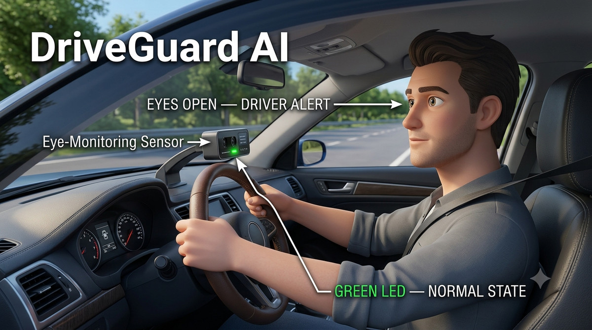
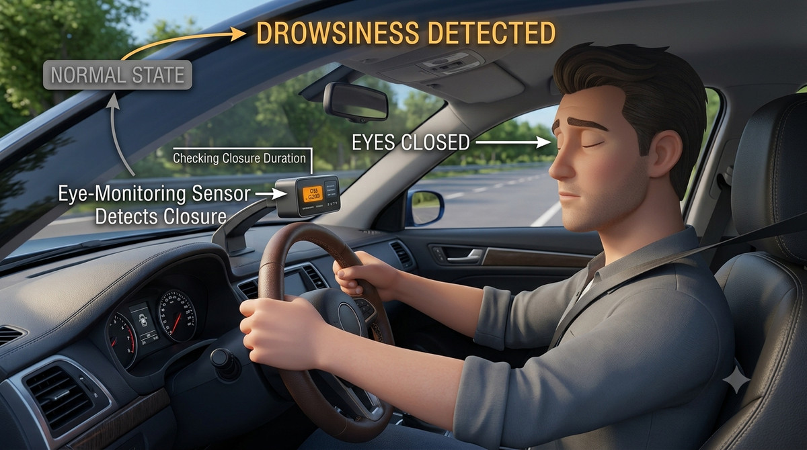
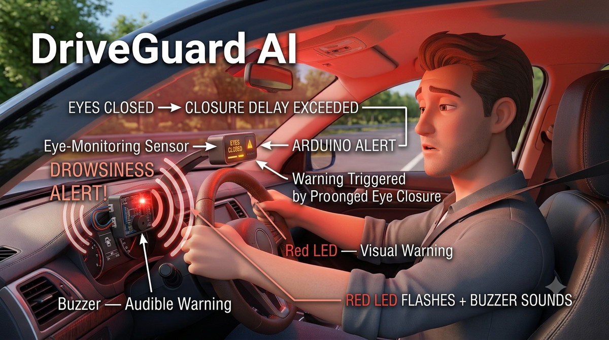
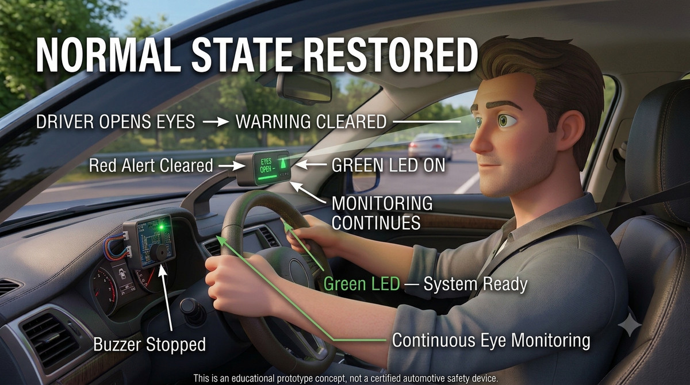

<<<<<<< HEAD
<div align="center">

# DriveGuard AI
### Intelligent Driver Drowsiness Detection & Alert System

**A computer-vision-based prototype that monitors eye closure and activates an Arduino warning when prolonged closure is detected.**


</div>

---

## Overview

**DriveGuard AI** is an educational driver drowsiness detection prototype. It uses a camera feed and computer vision to estimate whether the driver's eyes are open or closed. When the eyes remain closed beyond a configured duration, the Python application sends a serial signal to an Arduino Uno, which activates a red LED and buzzer. When the eyes reopen, the alert is cleared and normal monitoring continues.

The project demonstrates how computer vision, serial communication, and embedded hardware can work together in a real-time monitoring workflow.

> **Prototype note:** The generated illustrations below show a conceptual in-car installation. The implemented prototype uses a laptop webcam and a separate Arduino circuit; the illustrations are explanatory visuals, not photographs of the actual hardware setup.

## Workflow

<div align="center">

### 1 · Normal Monitoring



The camera captures frames and the vision pipeline estimates eye status. The system continues monitoring while the eyes are open.

### 2 · Eye Closure Detected



The eye-closure condition is detected and its duration is checked against the configured threshold.

### 3 · Alert Activated



If closure persists long enough, Python sends `CLOSED` over serial. The Arduino activates the red LED and buzzer to provide visual and audible warnings.

### 4 · Alert Cleared



When the eyes reopen, Python sends `OPEN`. The Arduino resets the alert state, turns off the warning outputs, and monitoring continues.

</div>

## Key Features

- **Real-time camera monitoring** using a webcam feed.
- **Eye-state estimation** using computer vision and facial landmarks.
- **Closure-duration check** to avoid triggering an alert for every brief blink.
- **Arduino serial communication** using `OPEN` and `CLOSED` signals.
- **Visual and audible alerts** through a red LED and buzzer.
- **Automatic reset** when the eyes reopen.
- **Modular design** separating vision logic from embedded alert control.

## System Flow

```text
Webcam frames
     |
     v
Python + OpenCV / MediaPipe
     |
     v
Estimate eye state and closure duration
     |
     +---- Eyes open ----------------> Send "OPEN"
     |                                   |
     |                                   v
     |                             Clear alert state
     |
     +---- Eyes closed too long ----> Send "CLOSED"
                                         |
                                         v
                                     Arduino Uno
                                         |
                                         v
                                Red LED + buzzer alert
```

## Technology Summary

| Area | Role |
|---|---|
| Python | Processes camera frames and determines eye state |
| OpenCV | Camera access and image processing |
| MediaPipe | Facial landmark detection, if used in the vision pipeline |
| Serial communication | Sends eye-state signals from Python to Arduino |
| Arduino Uno / embedded C | Controls alert outputs and timing |
| Red LED and buzzer | Visual and audible warning indicators |

## Applications

- Learning prototype for driver drowsiness monitoring.
- Demonstration of computer vision and embedded systems integration.
- Academic projects involving real-time detection and hardware alerts.
- Starting point for research into fatigue-monitoring interfaces.

## Limitations and Safety

- Lighting, camera angle, glasses, face position, and camera quality can affect detection.
- Eye closure alone does not reliably determine every form of fatigue or impairment.
- This is an **educational prototype**, not a certified automotive safety device.
- Do not rely on it as a replacement for rest, safe driving practices, or certified driver-assistance systems.
- The conceptual dashboard sensor shown in the illustrations is not part of the implemented prototype unless separately built.

## Future Enhancements

- Improve robustness across lighting conditions and different camera positions.
- Add configurable thresholds and an on-screen status dashboard.
- Record event timestamps for testing and evaluation.
- Evaluate detection performance on varied, consented test data.
- Explore additional fatigue cues, such as yawning or head pose, with appropriate validation.
- Design a compact, securely mounted hardware enclosure for controlled demonstrations.

## Conclusion

DriveGuard AI demonstrates an end-to-end workflow in which computer vision estimates eye state, Python communicates with an Arduino, and embedded hardware produces an alert when eye closure persists. It is a practical learning project at the intersection of **AI, computer vision, serial communication, and embedded systems**.

---

<div align="center">

**DriveGuard AI · Educational Prototype**

*Built to explore computer vision and embedded alert systems.*

</div>
=======
# 🚗 Driver Drowsiness Eye Blink Detection System

A real-time driver safety system that detects driver drowsiness using eye blink detection and triggers hardware alerts to prevent road accidents. This project combines **computer vision**, **Python**, and **embedded systems** to address a real-world safety-critical problem.

---

## 📌 Project Overview

Driver fatigue is one of the leading causes of road accidents, especially during long-distance driving.  
This system continuously monitors the driver’s eye state using a camera. If the driver’s eyes remain closed for more than **1.5 seconds**, the system identifies drowsiness and immediately triggers an alert using LEDs and a buzzer.

The project demonstrates how **software (Python + OpenCV)** can be effectively integrated with **hardware (Arduino)** to create a real-time safety solution.

---

## ✨ Key Features

- Real-time face and eye detection
- Accurate eye blink and eye-closure analysis
- Drowsiness detection with time threshold (1.5 seconds)
- Hardware alerts using LEDs and buzzer
- Continuous alert until driver regains alertness
- Low-cost and efficient design
- Suitable for real-world vehicle integration

---

## 🛠 Technologies Used

### Software
- **Programming Language:** Python
- **Libraries:** OpenCV
- **IDE:** Visual Studio Code

### Hardware
- Arduino Uno
- Camera (Webcam / USB Camera)
- Red LED (Drowsiness alert)
- Green LED (Normal state)
- Buzzer

### Communication
- Serial communication (USB)

---

## ⚙ System Architecture & Working

1. Camera continuously captures the driver’s face
2. Python processes video frames using OpenCV
3. Haar Cascade detects the face and eyes
4. Eye state is analyzed (open or closed)
5. Eye closure duration is measured
6. If eyes are closed for more than **1.5 seconds**:
   - Alert signal sent to Arduino
   - Red LED blinks
   - Buzzer sounds continuously
7. When eyes reopen:
   - Alert stops immediately
   - Green LED glows

---


>>>>>>> 993668387193ec4ec004c2514908293ba65b5c8c
